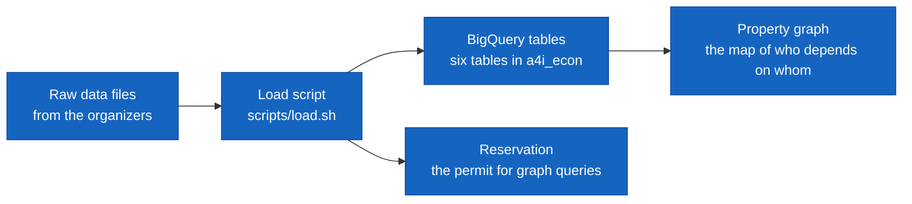
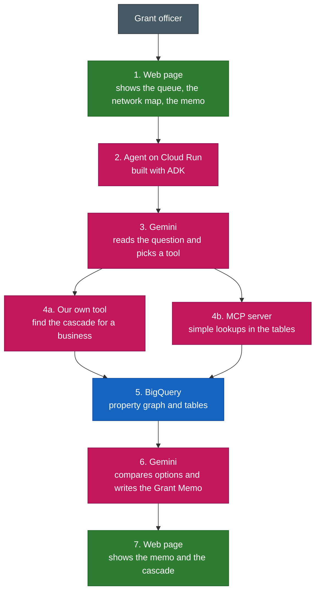

# How Our Solution Works, End to End

This page shows the full flow from the web page to the data and back. It also shows which Google Cloud service is used at each step, and which lane owns it.

For the problem summary, see [TEAM_BRIEF.md](TEAM_BRIEF.md).

## What is a Grant Memo?

The Grant Memo is the final answer our agent gives. It is a short written recommendation that a grant officer can take into a meeting and defend.

It contains:

- Which business to fund, and how much
- Which other businesses this protects, by name
- The chain of links that proves it
- Why this business and not the second best choice
- What we are assuming
- Which parts of the evidence are estimated
- Who lives in the neighborhood where the money lands

## Part 1: One time setup

This is done once, before the agent can answer anything. The data lane owns all of it.

| Step | What happens | Service |
|---|---|---|
| Load | The script copies the data into our project | Cloud Shell, BigQuery |
| Reservation | The script creates the permit that graph queries need | BigQuery |
| Graph | One SQL statement turns the tables into a map of dots and arrows | BigQuery property graph |

## Part 2: What happens when the officer asks a question

Colors: green is the front end lane, pink is the agent lane, blue is the data lane.

## Each step explained

| Step | What happens | Service used | Lane |
|---|---|---|---|
| 1. Web page | The officer picks a business or types a question, for example "Who should get the $50,000?" | Our web page, hosted on Cloud Run | Front end |
| 2. Agent | The agent receives the question. It is the manager that decides what to do next | ADK, running on Cloud Run | Agent |
| 3. Gemini thinks | Gemini reads the question and chooses which tool to use | Gemini on Vertex AI | Agent |
| 4a. Our own tool | Finds the cascade: which businesses are hurt if this one closes, two steps deep. It also holds our rules for weighing the damage | Python function in ADK | Agent writes the tool, data lane supplies the query |
| 4b. MCP server | Handles simple lookups, for example loan history or neighborhood poverty rate | BigQuery MCP server or MCP Toolbox | Agent |
| 5. BigQuery | Runs the graph query and returns the businesses and links | BigQuery property graph | Data |
| 6. Gemini writes | Gemini compares the best choice with the runner up, lists the assumptions, and writes the memo | Gemini on Vertex AI | Agent |
| 7. Web page | Shows the memo, and draws the cascade so the officer can see it | Our web page | Front end |

Steps 3 to 5 can repeat several times for one question. For example, the agent may check the cascade of five applicants before it writes the memo.

## Which service belongs to which lane

| Lane | People | Services | What they deliver |
|---|---|---|---|
| Data | 2 | BigQuery, property graph, reservation, Cloud Shell | Loaded tables, the graph, and a working cascade query |
| Agent | 3 | ADK, Gemini on Vertex AI, MCP server, Cloud Run | An agent that answers questions and writes the memo, deployed online |
| Front end | 1, shared with the agent lane | Web page on Cloud Run | The screen the officer uses, with the queue, the network map, and the memo |
| Story | Owner to be decided | Google Slides, screen recording | The 6 slide deck and the 3 minute video |

## Which platform each lane works in

| Lane | Where to work | What to do there |
|---|---|---|
| Data | Colab Enterprise | Run the notebook that loads and explains the data |
| Data | Cloud Shell | Backup: run `bash scripts/load.sh central-market` if the notebook fails |
| Data | BigQuery Studio | Write and test SQL and graph queries |
| Agent | Antigravity IDE, Cloud Shell Editor, or your own laptop | Write the ADK agent code in Python |
| Agent | `adk web` | Test the agent in a chat window while building |
| Agent | Cloud Run | Deploy the agent and get the live link |
| Front end | Your own laptop or Antigravity IDE | Build the web page |
| Story | Google Slides and a screen recorder | The 6 slide deck and the 3 minute video |
| Everyone | GitHub | One shared repo, one branch per lane |

## What each tool is

| Tool | What it is |
|---|---|
| Google Skills lab (Qwiklabs) | The event page that gives each of us a temporary Google account and opens our shared project |
| Google Cloud console | The main website where all the services are found |
| Colab Enterprise | Notebooks in the browser. You run Python and SQL one cell at a time and see the result under each cell |
| Cloud Shell | A terminal in the browser, with all Google tools already installed |
| Cloud Shell Editor | A code editor in the browser that comes with Cloud Shell |
| BigQuery Studio | The BigQuery page in the console where you write and run queries |
| Antigravity IDE | Google's code editor with an AI helper inside. It opens from a button in the lab page |
| Antigravity CLI | The same AI helper in the terminal. Type `agy` in Cloud Shell |
| `adk web` | A test chat window that comes with ADK. Good for building, weak as a final demo |
| MCP Toolbox for Databases | Google's ready made connector between an agent and BigQuery |
| Gemini Enterprise | A ready made chat product that can show our agent to internal users. An optional front end choice |
| Cloud Run | Hosts our agent and web page online |
| Agent Runtime | Another place to host an agent. We use Cloud Run, so this is optional |

Antigravity is recommended by the organizers but not required. Any editor is fine.

## Where the lanes meet

These are the hand over points. Agree on them early, because one lane is blocked until the other delivers.

| From | To | What is handed over |
|---|---|---|
| Data | Agent | The exact cascade query, and the graph name |
| Agent | Front end | The agent's web address, and the shape of its answer |
| Agent and Data | Story | One good example cascade, the bias numbers, and the list of limits |

## The four required pieces, and where they appear in the flow

| Requirement | Step in the flow |
|---|---|
| BigQuery property graph, followed at least two steps | Step 5 |
| A tool we wrote ourselves | Step 4a |
| A managed MCP server | Step 4b |
| Deployed on Google Cloud | Step 2 |
